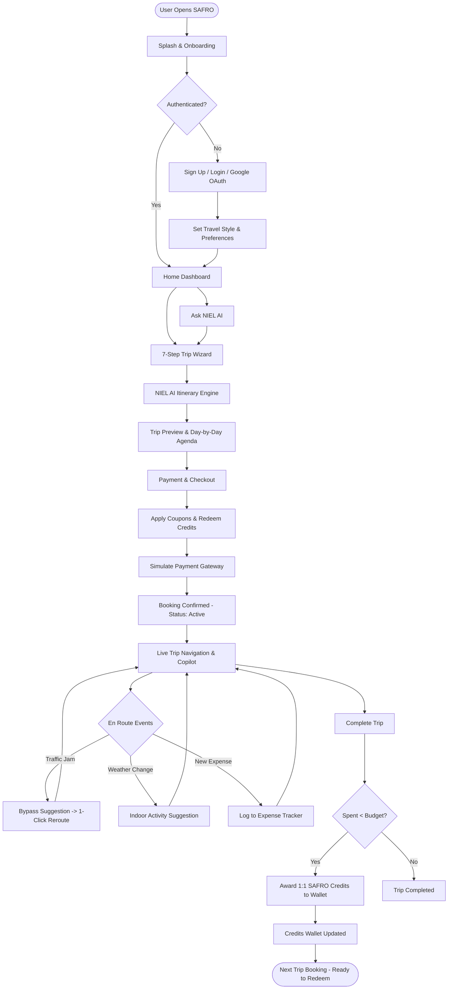
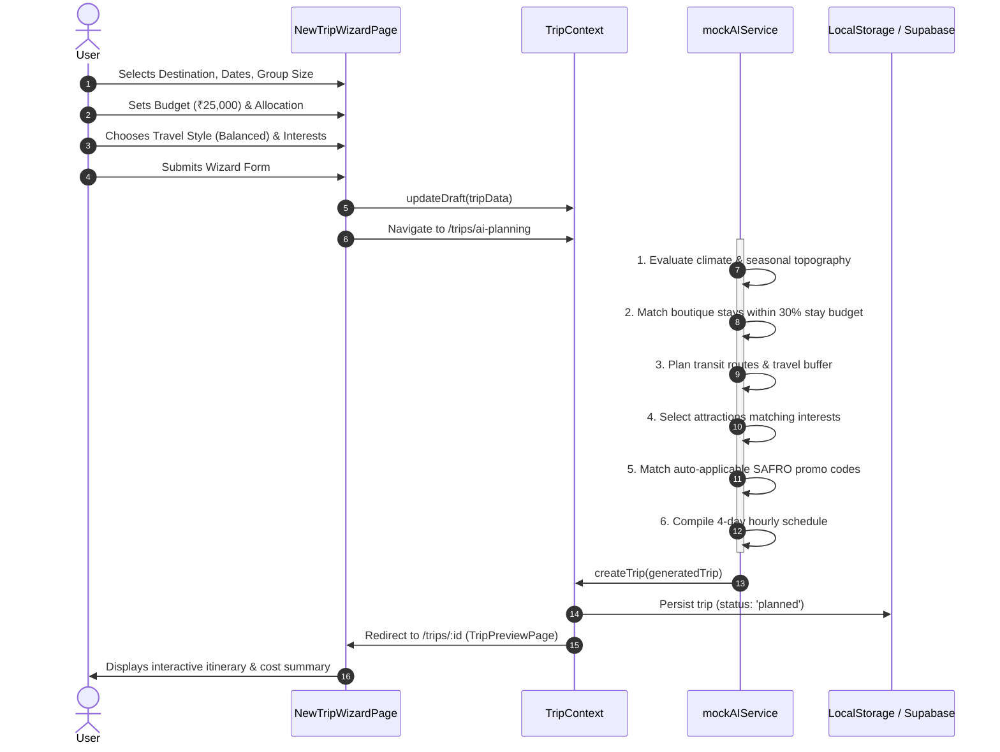
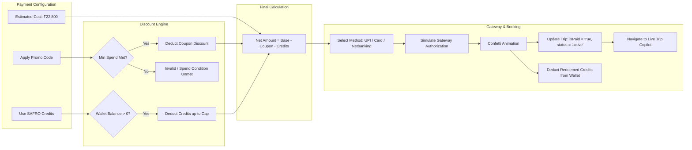
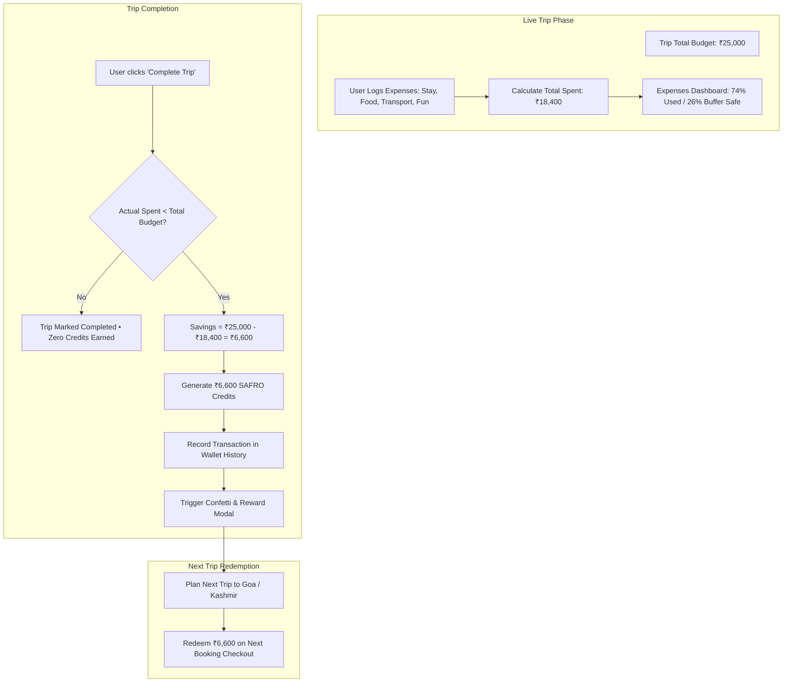
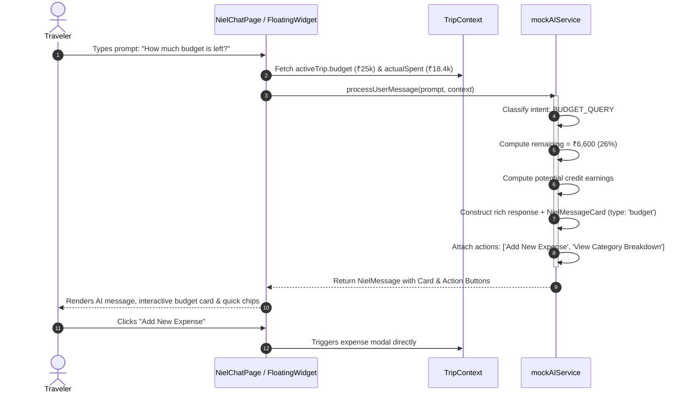

# SAFRO — Platform Features & System Workflow Specification

> **SAFRO** is an AI-powered smart travel planning, budgeting, live-navigation, and rewards platform built for modern travelers. Its core principle is: **"Travel smarter, stay under budget, and get rewarded with real credits."**

---

## Table of Contents
1. [Executive Overview & Value Proposition](#1-executive-overview--value-proposition)
2. [Comprehensive Feature Breakdown](#2-comprehensive-feature-breakdown)
   - [2.1 Authentication & Profile Personalization](#21-authentication--profile-personalization)
   - [2.2 7-Step Trip Creation Wizard](#22-7-step-trip-creation-wizard)
   - [2.3 NIEL AI Autonomous Itinerary Synthesis Engine](#23-niel-ai-autonomous-itinerary-synthesis-engine)
   - [2.4 Interactive Trip Preview & Itinerary Management](#24-interactive-trip-preview--itinerary-management)
   - [2.5 Smart Checkout, Dynamic Coupons & Credit Redemption](#25-smart-checkout-dynamic-coupons--credit-redemption)
   - [2.6 Live Navigation & Active Trip Copilot](#26-live-navigation--active-trip-copilot)
   - [2.7 Real-time Expense Tracking & Budget Health](#27-real-time-expense-tracking--budget-health)
   - [2.8 SAFRO Credits Reward Engine](#28-safro-credits-reward-engine)
   - [2.9 Partner Offers & Curated Discounts](#29-partner-offers--curated-discounts)
   - [2.10 NIEL AI Context-Aware Travel Companion (Chat & Floating Widget)](#210-niel-ai-context-aware-travel-companion-chat--floating-widget)
   - [2.11 Notifications & Settings](#211-notifications--settings)
3. [Architectural Workflow Design](#3-architectural-workflow-design)
   - [3.1 High-Level End-to-End User Journey](#31-high-level-end-to-end-user-journey)
   - [3.2 Trip Creation & AI Synthesis Pipeline](#32-trip-creation--ai-synthesis-pipeline)
   - [3.3 Payment, Promo Code & Credit Redemption Flow](#33-payment-promo-code--credit-redemption-flow)
   - [3.4 Live Navigation, Incident Detection & Dynamic Rerouting](#34-live-navigation-incident-detection--dynamic-rerouting)
   - [3.5 Budget Health & Post-Trip Savings Reward Loop](#35-budget-health--post-trip-savings-reward-loop)
   - [3.6 NIEL AI Chat & Multi-Modal Context Flow](#36-niel-ai-chat--multi-modal-context-flow)
4. [Data Models & State Architecture](#4-data-models--state-architecture)
5. [Technical Stack & Integrations](#5-technical-stack--integrations)

---

## 1. Executive Overview & Value Proposition

Traditional travel planning tools require users to juggle flight bookings, hotel reservations, maps, separate budgeting spreadsheets, and review apps.

**SAFRO** unifies the entire lifecycle into an autonomous, closed-loop experience:
1. **Personalized AI Generation**: Tailors day-by-day itineraries based on travel style, budget ceilings, and specific interests.
2. **Dual-Engine Geospatial Routing**: Integrates Google Maps JavaScript SDK and Leaflet for real-time tracking, terrain overlays, and alternative route suggestions.
3. **Budget Accountability & Real Rewards**: Unlike points with negligible value, SAFRO offers 1:1 INR credits. When travelers finish a trip under budget, their unspent savings convert into SAFRO Credits for their next adventure.
4. **Autonomous Copilot (NIEL)**: Continuously monitors weather disruptions and traffic bottlenecks to recommend proactive adjustments on the fly.

---

## 2. Comprehensive Feature Breakdown

### 2.1 Authentication & Profile Personalization
- **Hybrid Authentication**: Powered by Supabase Auth with fallback local session management. Supports email/password credentials, password recovery, and Google OAuth.
- **Onboarding & Splash Flow**: Introduces users to the SAFRO ecosystem with animated value propositions (Smart Planning, Live Navigation, Real Rewards).
- **Travel Preferences Engine**:
  - **Travel Styles**:
    - *Budget Explorer*: Hostels, public transit, local street food, high-value deals.
    - *Balanced Traveler*: Boutique hotels, curated activities, authentic cafes.
    - *Premium Luxury*: 5-star resorts, private transfers, bespoke VIP experiences.
  - **Traveler Interests**: Multi-select tags (Nature, Adventure, Food & Dining, Culture & Heritage, Shopping, Relaxation).
  - **Preferred Transport**: Walking, Public Transit, Private Car, Taxi / Cab.

### 2.2 7-Step Trip Creation Wizard
A step-by-step wizard (`/trips/new`) that guides travelers with instant feedback:
1. **Destination Selection**: Select from popular destinations (Manali, Goa, Jaipur, Rishikesh, Kerala, Ladakh) or search any global city.
2. **Dates & Duration**: Dynamic counter for trip duration in days.
3. **Travelers**: Group sizing selector (Solo, Duo, Family/Friends).
4. **Smart Budget Estimator**: Sliders ranging from ₹5,000 to ₹1,00,000+ with automatic algorithmic allocation:
   - **Stay**: 30% of total budget
   - **Transport**: 20% of total budget
   - **Activities**: 20% of total budget
   - **Food & Dining**: 15% of total budget
   - **Buffer / Miscellaneous**: 15% of total budget
5. **Travel Style Selector**: Customizes pace and lodging tier.
6. **Interest Customization**: Filters attractions to match user preferences.
7. **Transport Mode**: Determines route calculations and waypoint transit times.

### 2.3 NIEL AI Autonomous Itinerary Synthesis Engine
Upon wizard completion, the request enters the **AI Planning Engine** (`/trips/ai-planning`):
- Animated radar scan and NIEL mascot visualization.
- **6-Stage Synthesis Pipeline**:
  1. Destination climate & topography analysis.
  2. Matching top-rated boutique stays within designated budget constraints.
  3. Optimizing scenic travel routes & waypoint timing.
  4. Fetching real-time activity admission fees & booking slots.
  5. Applying applicable partner promo codes & SAFRO discount coupons.
  6. Generating day-by-day personalized itineraries with time blocks, estimated costs, and coordinates.

### 2.4 Interactive Trip Preview & Itinerary Management
Located at `/trips/:id`:
- **Hero Display**: Cover imagery, active status badges, duration, travelers, and travel style tags.
- **Tabbed Views**:
  - **Overview**: Budget health gauge, key highlights, trip summary, and inclusions.
  - **Day-by-Day Itinerary**: Accordion-based agenda per day with activity time badges, categories (Stay, Food, Activities, Transport), duration, and estimated pricing.
  - **Places to Visit**: Photo cards of iconic landmarks with descriptions.
  - **Route Map**: Embedded interactive map displaying key waypoints.
- **Pricing & Checkout Summary**: Displays base estimated costs, applied coupons, credit deductions, and net payable balance.

### 2.5 Smart Checkout, Dynamic Coupons & Credit Redemption
Located at `/trips/:id/payment`:
- **Payment Methods**:
  - UPI (Instant QR code generation, Google Pay, PhonePe, Paytm).
  - Credit / Debit Cards (with CVV, expiry validation).
  - Net Banking & Digital Wallets.
- **Coupon Code Validation**: Real-time validation against minimum spend thresholds:
  - `SAFRO2026`: Flat ₹1,200 discount (min. spend ₹15,000).
  - `STAY1000`: Flat ₹1,000 discount on resort bookings (min. spend ₹5,000).
  - `DINE20`: 20% off gourmet dining (up to ₹800).
  - `ADVENTURE300`: Flat ₹300 off adventure activities.
- **SAFRO Credits 1:1 Redemption**: Direct rupee-for-rupee deduction (up to wallet balance or trip cap).
- **Simulated Payment Gateway**: Real-time processing simulation with celebratory confetti and status transition to `active` and `isPaid`.

### 2.6 Live Navigation & Active Trip Copilot
Located at `/trips/:id/live`:
- **Dual-Engine Interactive Map**:
  - Primary: Google Maps JavaScript API with customized light slate styling.
  - Fallback: Leaflet & OpenStreetMap tiles for zero-dependency offline resilience.
- **Live Vehicle Telemetry**:
  - Vehicle coordinates, speed meter (km/h), waypoints, and destination marker.
  - Normal ETA vs. Current ETA calculation with delay tracking.
- **Proactive Traffic Alert & 1-Click Scenic Bypass**:
  - Monitors upcoming congestions (e.g. NH3 Palchan Bridge bottleneck).
  - Recommends an alternative route (e.g. scenic bypass via Old Burua Road).
  - 1-click **"Switch to Bypass"** button instantly redraws route polyline on map, updates ETA, and saves 18+ minutes.
- **Hyper-Local Weather Shield**:
  - Monitors destination microclimates (e.g., rainfall in Solang Valley at 3:00 PM).
  - Recommends indoor alternatives with 1-click acceptance (e.g., heated Snow World Lounge 2.4 km ahead).
- **Trip Completion Trigger**:
  - Allows marking the trip complete, calculates actual spend vs budget, and unlocks SAFRO credits.

### 2.7 Real-time Expense Tracking & Budget Health
Located at `/trips/:id/expenses` & `/expenses`:
- **Categorized Logging**: Stay, Transport, Food, Activities, and Other.
- **Visual Analytics**:
  - Progress bar showing percentage of budget spent vs remaining.
  - Category breakdown with visual badge amounts.
  - Chronological transaction feed with payment method tags (UPI, Card, Cash).
- **Expense Logging Modal**: Rapid modal to add new receipts on the road.

### 2.8 SAFRO Credits Reward Engine
Located at `/credits`:
- **1:1 Rupee Reward Value**: 1 SAFRO Credit = ₹1 INR.
- **Savings Incentive Loop**:
  $$\text{Credits Earned} = \max(0, \text{Total Budget} - \text{Actual Spent})$$
  When a user saves ₹3,200 on a trip, ₹3,200 is deposited into their wallet.
- **Transaction Ledger**: Historical audit trail of credits earned, redeemed on bookings, or awarded through bonuses.

### 2.9 Partner Offers & Curated Discounts
Located at `/offers`:
- Browse verified discounts across Stays, Dining, and Adventure Sports.
- 1-Click Apply to the active trip draft.
- Expiry date tracking and minimum spend eligibility indicators.

### 2.10 NIEL AI Context-Aware Travel Companion (Chat & Floating Widget)
Accessible via bottom-right floating widget or dedicated `/niel-ai` interface:
- **Context Injection**: NIEL reads the user's active trip, budget, amount spent, current location, and route alerts.
- **Interactive Action Cards**:
  - *Weather Cards*: Weather advisories with alternative indoor suggestions.
  - *Route Cards*: Traffic delay warnings with 1-click alternative bypass buttons.
  - *Stay Cards*: Cheaper verified hotel alternatives saving up to ₹1,400/night.
  - *Budget Health Check Cards*: Live percentage used, remaining budget, and potential credit reward forecast.
- **Suggested Quick Prompts**: One-tap query chips ("Plan a trip to Manali", "Is there traffic on my route?", "How much budget is remaining?").

### 2.11 Notifications & Settings
- **Notification Modal**: Alerts for trip updates, traffic warnings, promo drops, and credit balance changes.
- **Settings Page**: Preferences for currency (INR), notifications, dark mode preferences, and cache clearing.

---

## 3. Architectural Workflow Design

### 3.1 High-Level End-to-End User Journey



---

### 3.2 Trip Creation & AI Synthesis Pipeline



---

### 3.3 Payment, Promo Code & Credit Redemption Flow



---

### 3.4 Live Navigation, Incident Detection & Dynamic Rerouting

```mermaid
flowchart TD
    StartNav([User Starts Journey]) --> GPS[Telemetry Ingestion: Vehicle Coords & Speed]
    GPS --> RenderMap[Render on InteractiveMap (Google Maps / Leaflet)]
    RenderMap --> Monitor[Background Incident Monitor]

    Monitor --> CheckTraffic{Congestion Detected Ahead?}
    CheckTraffic -- Yes --> AlertTraffic[Trigger Traffic Alert: Heavy Jam on NH3 +26m]
    AlertTraffic --> NIELSuggest1[NIEL Suggests: Old Burua Scenic Bypass]
    NIELSuggest1 --> UserChoice1{User Action}
    UserChoice1 -- Click Accept --> UpdatePolyline[Swap Waypoints to Bypass Path]
    UpdatePolyline --> RecalcETA[Save 18 mins • Update Live ETA]
    UserChoice1 -- Dismiss --> KeepRoute[Stay on NH3 Highway]

    Monitor --> CheckWeather{Inclement Weather Detected?}
    CheckWeather -- Yes --> AlertWeather[Trigger Weather Alert: Rain at Solang 3 PM]
    AlertWeather --> NIELSuggest2[NIEL Suggests: Heated Snow World Lounge 2.4km ahead]
    NIELSuggest2 --> UserChoice2{User Action}
    UserChoice2 -- Click Accept --> AddIndoor[Update Day Itinerary with Indoor Activity]
    UserChoice2 -- Dismiss --> MaintainSchedule[Keep Outdoor Plan]

    RecalcETA --> DestReached[Arrive at Destination]
    KeepRoute --> DestReached
    AddIndoor --> DestReached
    MaintainSchedule --> DestReached
```

---

### 3.5 Budget Health & Post-Trip Savings Reward Loop



---

### 3.6 NIEL AI Chat & Multi-Modal Context Flow



---

## 4. Data Models & State Architecture

### Core TypeScript Interfaces (`src/types/index.ts`)

| Interface / Type | Purpose | Key Attributes |
| :--- | :--- | :--- |
| `Trip` | Master entity for a trip | `id`, `title`, `destination`, `startDate`, `durationDays`, `travelers`, `travelStyle`, `budget`, `estimatedCost`, `actualSpent`, `appliedOfferDiscount`, `creditsUsed`, `status`, `isPaid`, `itinerary`, `liveStatus` |
| `TripDay` | Day container within a trip | `dayNumber`, `title`, `date`, `activities: ItineraryActivity[]` |
| `ItineraryActivity`| Individual scheduled event | `id`, `time`, `title`, `location`, `duration`, `estimatedCost`, `category`, `notes`, `isCompleted` |
| `LiveTripStatus` | Live telemetry & incident state| `currentLocationName`, `destinationName`, `etaNormal`, `etaCurrent`, `delayMinutes`, `currentSpeedKmH`, `weatherAlert`, `trafficAlert`, `vehicleCoords`, `destinationCoords`, `waypoints` |
| `Expense` | Single spend item | `id`, `tripId`, `category`, `description`, `amount`, `date`, `paymentMethod` |
| `Offer` | Promotional discount code | `id`, `code`, `title`, `discountAmount`, `discountPercent`, `category`, `minSpend`, `validUntil`, `tag` |
| `CreditTransaction`| Ledger audit for SAFRO credits | `id`, `date`, `type` (`earned`, `redeemed`, `bonus`), `amount`, `description`, `tripId` |
| `NielMessage` | Chat message model | `id`, `sender` (`user`, `niel`), `timestamp`, `content`, `card?: NielMessageCard`, `actions?: NielMessageAction[]` |
| `UserProfile` | Account details & preferences | `id`, `name`, `email`, `avatarUrl`, `location`, `phone`, `preferences: TravelPreferences` |

---

## 5. Technical Stack & Integrations

1. **Frontend Framework**: React 19 + TypeScript + Vite.
2. **Routing**: React Router DOM (v7) with `ProtectedRoute` and `PublicOnlyRoute` authentication guards.
3. **Styling & Design System**: Tailwind CSS v4, Lucide React icons, Framer Motion animations.
4. **Interactive Mapping**:
   - Google Maps JavaScript SDK with dynamic async loader (`googleMapsLoader.ts`).
   - Leaflet + OpenStreetMap fallback for offline/resilient mapping.
5. **Backend & Persistence**:
   - Supabase (`@supabase/supabase-js`) for User Authentication and database profile synchronization.
   - LocalStorage synchronization for offline persistence across trips, expenses, credits, and active drafts.
6. **Code Quality**: Oxlint (Oxc linter) configured for sub-second analysis.

---

*Document generated for SAFRO Platform Architecture & Engineering Overview.*
